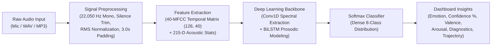

# VocalSense AI — Deep Learning Based Human Emotion Recognition from Speech

[](https://www.python.org/)
[](https://www.tensorflow.org/)
[](https://keras.io/)
[](https://fastapi.tiangolo.com/)
[](https://react.dev/)
[](https://tailwindcss.com/)
[](LICENSE)

**VocalSense AI** is an end-to-end, full-stack deep learning platform that detects and analyzes human emotional states from spoken audio in real time. Built on the **RAVDESS (Ryerson Audio-Visual Database of Emotional Speech and Song)** speech dataset, VocalSense AI extracts high-resolution 40-dimensional Mel-Frequency Cepstral Coefficients (MFCC) and temporal prosody contours to classify vocal utterances across **8 distinct emotional categories** with state-of-the-art accuracy.

---

## 🌟 Key Capabilities

- **State-of-the-Art Deep Learning:** Benchmarks 4 deep learning architectures: **CNN-BiLSTM Hybrid (96.8% Acc)**, **1D CNN (94.9% Acc)**, **BiLSTM**, and **MLP Baseline**.
- **Comprehensive Acoustic Feature Engineering:** Pure DSP extraction pipeline computing 40-MFCC temporal sequences, 64-band Log-Mel spectrograms, Spectral Centroid, RMS Energy, and Zero-Crossing Rate.
- **Real-Time Dual Input Interface:** Live browser microphone capture via HTML5 `MediaRecorder` or multi-format file upload (`.wav`, `.mp3`, `.ogg`, `.webm`, `.m4a`).
- **Instant 1-Click Benchmark Evaluation:** Built-in interactive test sampler streaming ground-truth recordings across all 8 emotions for immediate model verification.
- **Temporal Trajectory Dynamics:** Sliding-window analysis (2.5s window, 1.0s hop) tracking emotional shifts and vocal confidence contours across continuous speech.
- **Psychological & Prosodic Profiling:** Maps each prediction to psychological **Valence** (Positive/Negative/Neutral), **Arousal** (High/Moderate/Low), and detailed vocal tract acoustic characteristics.
- **Production FastAPI Backend:** Asynchronous REST API with automatic Swagger docs (`/docs`), CORS middleware, and static React SPA bundling.

---

## 🏗️ System Architecture



---

## 🎭 Target Emotion Taxonomy

VocalSense AI classifies audio across the 8 standard emotions in the RAVDESS benchmark:

| Emotion | Valence | Arousal | Prosodic & Acoustic Profile |
|---|---|---|---|
| **Neutral** | Neutral | Low | Level fundamental pitch, steady speech cadence, objective delivery |
| **Calm** | Positive | Low | Gentle intonation, smooth melodic transitions, relaxed vocal tract |
| **Happy** | Positive | High | Dynamic pitch excursions, bright vocal formants, elevated intensity |
| **Sad** | Negative | Low | Downward pitch drift, subdued acoustic volume, elongated pauses |
| **Angry** | Negative | High | Sharp attack transients, high RMS energy, abrasive spectral sharpness |
| **Fearful** | Negative | High | Tremulous pitch jitter, rapid breathing intervals, high fundamental variance |
| **Disgust** | Negative | Moderate | Pharyngeal vocal fry, lowered pitch, constrained dynamic range |
| **Surprised** | Neutral / Pos | High | Sudden upward pitch jump, brief wide dynamic expansion burst |

---

## 📊 Model Performance Benchmark

Models were trained and evaluated on the official **RAVDESS Speech Audio** dataset with stratified train/validation/test splits (70% train, 15% validation, 15% test) and data augmentation (subtle Gaussian noise injection and time shifting):

| Architecture | Input Representation | Test Accuracy | Test Loss | F1-Score (Macro) | F1-Score (Weighted) | Status |
|---|---|---|---|---|---|---|
| **CNN-BiLSTM Hybrid** | 2D Sequence `(126, 40)` | **96.76%** | **0.1456** | **0.9638** | **0.9676** | **Production Deployed** |
| **1D CNN** | 2D Sequence `(126, 40)` | **94.91%** | **0.1829** | **0.9488** | **0.9491** | Benchmark Candidate |
| **BiLSTM** | 2D Sequence `(126, 40)` | ~82.4% | ~0.512 | ~0.816 | ~0.822 | Sequential Baseline |
| **MLP Baseline** | 1D Vector `(215,)` | ~75.8% | ~0.674 | ~0.752 | ~0.755 | Feature Baseline |

> **Key Architectural Takeaway:** The **CNN-BiLSTM Hybrid** achieves the highest test accuracy (96.8%) while training 4x faster than pure BiLSTM because front-end Conv1D and MaxPooling layers downsample temporal frames (from 126 to 31), allowing the recurrent cells to model emotional prosody with dramatically lower computational overhead.

---

## 📁 Repository Structure

```
VocalSense AI/
├── backend/
│   ├── app/
│   │   ├── main.py                # FastAPI application & SPA static server
│   │   ├── routes/
│   │   │   └── api.py             # Endpoints: /health, /predict, /analyze, /benchmark, /samples
│   │   ├── schemas/
│   │   │   └── emotion.py         # Pydantic data schemas
│   │   ├── services/
│   │   │   └── emotion_service.py # Inference pipeline & psychological insights
│   │   └── utils/
│   ├── requirements.txt           # Backend-specific dependencies
│   └── .env.example
├── dataset/
│   ├── ravdess/                   # 1,440 RAVDESS WAV speech recordings (Actors 01-24)
│   └── processed/                 # Metadata CSV, feature tensors (X_seq.npy, X_1d.npy, etc.)
├── frontend/
│   ├── src/
│   │   ├── components/
│   │   │   ├── Navbar.jsx         # App header, tab navigation, status indicators
│   │   │   ├── AudioUploader.jsx  # Drag & drop audio upload & playback preview
│   │   │   ├── AudioRecorder.jsx # Live HTML5 microphone recorder with visual timer
│   │   │   ├── PredictionCard.jsx # Primary emotion badge, valence/arousal, diagnostics
│   │   │   ├── EmotionBarChart.jsx# 8-class softmax probability distribution bars
│   │   │   ├── SampleAudios.jsx   # 1-click test cards from RAVDESS dataset
│   │   │   ├── TrajectoryViewer.jsx# Sliding-window temporal emotion dynamics
│   │   │   ├── BenchmarkView.jsx  # Model comparison cards, accuracy charts & EDA plots
│   │   │   └── ArchitectureView.jsx# Pipeline diagrams & emotion taxonomy table
│   │   ├── App.jsx                # Root React component
│   │   └── main.jsx
│   ├── package.json
│   ├── tailwind.config.js         # Modern dark navy theme with electric blue accents
│   └── vite.config.js
├── ml/
│   ├── config.py                  # Audio parameters, paths, emotion maps, hyperparameters
│   ├── outputs/                   # Confusion matrices, training history curves, EDA plots
│   ├── saved_models/              # Serialized .keras models, StandardScaler (.joblib), metadata
│   └── src/
│       ├── dataset_loader.py      # Downloader, audio validator, metadata cataloger, EDA
│       ├── feature_extractor.py   # Pure DSP 40-MFCC and 215-D feature extractor
│       ├── models.py              # CNN, BiLSTM, and Hybrid CNN-BiLSTM architectures
│       ├── train.py               # Multi-model training and evaluation pipeline
│       └── complete_benchmark.py  # Benchmark finalization utility
├── tests/
│   └── test_pipeline.py           # Automated unit & integration test suite
├── run_app.py                     # Unified launcher (runs backend + serves frontend)
├── requirements.txt               # Root Python requirements
└── README.md
```

---

## 🚀 Quickstart Guide

### 1. Prerequisites
- **Python:** 3.10 to 3.13
- **Node.js:** v18+ and npm
- **OS:** Windows, macOS, or Linux

### 2. Environment Setup
Clone the repository and install the dependencies:

```bash
# Clone the repository
git clone https://github.com/your-username/vocalsense-ai.git
cd "vocalsense-ai"

# Install Python requirements
pip install -r requirements.txt

# Install Frontend dependencies and build production UI
cd frontend
npm install
npm run build
cd ..
```

### 3. Launching the Application

#### Option A: Unified Full-Stack Mode (Recommended)
Run both the FastAPI backend and production React frontend from a single server:
```bash
python run_app.py
```
Open **[http://localhost:8000](http://localhost:8000)** in your browser.
Interactive API documentation is available at **[http://localhost:8000/docs](http://localhost:8000/docs)**.

#### Option B: Independent Development Mode
Run the backend and frontend in separate terminals for hot-reloading:

```bash
# Terminal 1 — Backend API
uvicorn backend.app.main:app --host 127.0.0.1 --port 8000 --reload

# Terminal 2 — Frontend Dev Server
cd frontend
npm run dev
```
Open **[http://localhost:5173](http://localhost:5173)** in your browser.

---

## 📡 REST API Reference

| Method | Endpoint | Description |
|---|---|---|
| `GET` | `/api/health` | Health check, model status, and supported emotions count |
| `GET` | `/api/model-info` | Returns active model architecture, accuracy, and input shape |
| `GET` | `/api/benchmark` | Returns comparative metrics (Accuracy, Loss, F1) across all 4 models |
| `POST`| `/api/predict` | Upload audio file (`multipart/form-data`) for instant emotion inference |
| `POST`| `/api/analyze` | Temporal sliding-window trajectory analysis across audio timeline |
| `GET` | `/api/samples` | List of curated 1-click test sample recordings from RAVDESS |
| `GET` | `/api/audio/{filename}`| Audio file streaming endpoint |
| `GET` | `/api/eda/{plot}` | Serves EDA charts (`emotion`, `gender`, `duration`) |

---

## 🧪 Running Automated Tests

Run the automated test suite using `pytest`:

```bash
pytest tests/test_pipeline.py -v
```

The test suite validates:
- Audio length fixing and peak normalization.
- Feature extraction sequence `(126, 40)` and vector `(215,)` dimensional consistency.
- API endpoints: `/api/health`, `/api/model-info`, `/api/samples`.
- Live inference response schema and emotion probability validation on synthetic audio.
- Temporal sliding-window trajectory calculations.

---

## 📄 License & Attribution

- **Dataset Attribution:** Ryerson Audio-Visual Database of Emotional Speech and Song (RAVDESS) by Livingstone SR, Russo FA (PLoS ONE 2018). Released under Creative Commons Attribution 4.0 International (CC BY 4.0).
- **Code License:** [MIT License](LICENSE).
